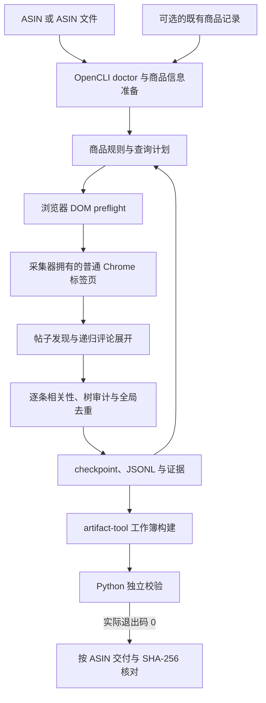

# 详细说明

> 本文件是 README 的完整版：README 已改为适合扫读的简版，迁移前 README 里的运行环境、安装步骤、完整命令、工作簿表结构、计数口径、数据边界、项目文件清单、历史验收与开发状态等细节，都完整保存在这里，内容与迁移前 README 一致，未删减任何信息。
>
> 迁移前 README 标题：Reddit VOC 评论采集器。以下按原章节顺序完整保留迁移前 README 原文，原文中的相对链接路径以仓库根目录为基准，未做改写；原文中的 mermaid 架构图一并保留。

# Reddit VOC 评论采集器

## 一眼看懂

- 这是什么：按商品编号采集 Reddit 上相关公开评论。
- 什么时候用：想找 Reddit 上某款商品的公开评论时。
- 给它什么：商品编号，或一份商品编号清单文件。
- 它给你什么：一个 Excel，含评论、回复关系和采集过程记录。

## 项目简介

`reddit-voc-collector` 是由 Amazon ASIN 驱动的 Reddit 公开评论采集工具和 Agent Skill，当前版本为 `2.1.0`。默认通过 OpenCLI 操作采集器创建的普通 Chrome 标签页，根据商品信息生成查询，逐条判断评论相关性，保留回复关系与断点，生成经校验的 Excel。

默认流程使用 OpenCLI；仓库中的 Playwright/CDP、选定标签页及 RC1 扩展桥是显式选择的兼容路径。根目录 [SKILL.md](SKILL.md) 定义 Agent 的运行约定。

## 核心功能

- 支持单 ASIN、多个 ASIN 和本地 ASIN 文件；从可见 Amazon 商品信息生成查询，可补充明确关联的卖家精灵关键词。
- 串行发现帖子、展开评论和回复，保存评论 ID、父子关系、深度、来源与展开进度。
- 逐条执行商品相关性规则，区分 `direct_product`、`competitive_context`、`unmet_need`，不把相关帖子中的全部回复都当作有效 VOC。
- 按评论 ID 和规范化链接跨帖子、跨 ASIN 去重，合并关联信息并保存 checkpoint；同一运行目录可续采和重审 PARTIAL 证据。
- 默认 `strict` 仅计入合格 PASS 评论；显式 `relevance` 模式仅放宽数量对账条件，将已校验 PARTIAL 单独标记和计数。
- 生成分层 Excel，校验工作簿、原始记录、审计证据和计数一致性；校验进程退出码为 0 后，才按 ASIN 命名并验证交付副本的 SHA-256。

评论数量指全局去重后的合格评论，不是帖子数，也不是多个 ASIN 工作簿行数的简单相加。间接 VOC 不等同于该 ASIN 的购买评价。

## 技术栈

| 用途 | 技术 | 仓库约束 |
| --- | --- | --- |
| 默认浏览器编排 | Node.js、OpenCLI | Node.js ≥ 20；OpenCLI CLI/扩展需另行准备 |
| 规划、规范化、校验 | Python、openpyxl | Python ≥ 3.10 且 < 3.14；openpyxl ≥ 3.1 且 < 4 |
| 默认 Excel 生成 | `@oai/artifact-tool` | 使用外部 Codex bundled runtime 或环境变量指定的等价运行时，未随仓库打包 |
| 兼容浏览器路径 | Playwright、Chrome 扩展、Python 本地桥 | `package.json` 声明 Playwright ≥ 1.55 且 < 2；不作为 OpenCLI 默认流程的备用重试 |
| 测试与持续集成 | unittest、Node test、GitHub Actions | Windows/macOS/Linux；CI 使用 Python 3.10/3.13、Node.js 20 |

`.python-version` 为 `3.12.13`。当前默认导出器为 `scripts/build_opencli_workbook.mjs`，旧 Python 工作簿构建器仅用于兼容流程。

## 快速开始

### 准备源码与环境

```bash
git clone https://github.com/fubo-ops/reddit-voc-collector.git
cd reddit-voc-collector
python -m pip install -r requirements.txt
node scripts/reddit_playwright_collector.cjs --help
python -B scripts/quick_validate.py .
```

上述安装文件已在仓库中提供；`--help` 和 Skill 格式检查不启动采集。系统命令名为 `python3` 时可替换 `python`。真实采集还需要已安装的 OpenCLI CLI/Chrome 扩展和人工完成登录的 Chrome；Excel 生成需要外部 artifact-tool 运行时。

`OPENCLI_ENTRY`、`ARTIFACT_NODE_MODULES`、`ARTIFACT_NODE`、`REDDIT_PYTHON` 可指定现有外部工具位置。设置方式见 [采集指南](references/collection-guide.md)。需要兼容 Playwright 路径时，才按 [package.json](package.json) 安装对应 Node 依赖。

Windows 可用现有脚本复制 Skill 并执行离线环境检查：

```powershell
powershell -ExecutionPolicy Bypass -File .\install.ps1
powershell -ExecutionPolicy Bypass -File .\doctor.ps1 -Offline
```

安装脚本复制指定 Skill 文件，不安装外部运行时，也不启动 Chrome。历史文档位于源码仓库的 `docs/archive/`，不在该安装脚本的复制清单内。`offline_ready` 只表示本地检查通过，不代表浏览器已连接。

### 真实采集

以下命令会使用浏览器；将 `ASIN` 替换为目标商品编号：

```bash
node scripts/reddit_playwright_collector.cjs doctor
node scripts/reddit_playwright_collector.cjs preflight --asin ASIN --out-dir outputs/run-001
node scripts/reddit_playwright_collector.cjs collect --asin ASIN --target-comments 500 --out-dir outputs/run-001 --delivery-dir outputs/delivery
```

多 ASIN 可改用 `--asins ASIN1,ASIN2` 或 `--asin-file FILE`。已有、保留来源信息的商品记录可通过 `--metadata-json FILE` 提供；缺少商品信息时停止，不能凭空生成种子。续跑使用同一 `--out-dir`，不要换空目录冒充续采。

浏览器操作严格串行。非 ready、加载失败、身份变化、登录墙或可见访问限制出现时停止；不会自动切换到兼容路径继续尝试。默认导航间隔为 8–15 秒，展开操作间隔为 1–3 秒。

### 导出与校验

```bash
node scripts/reddit_playwright_collector.cjs export --out-dir outputs/run-001 --delivery-dir outputs/delivery
node scripts/reddit_playwright_collector.cjs validate --out-dir outputs/run-001
```

`strict` 工作簿含 6 张表；`relevance` 增加合并计数表和单列 PARTIAL 表，共 8 张：

| 工作表 | 用途 |
| --- | --- |
| `Comments` | 仅 relevance：合并计入目标的两类评论 |
| `Trusted_Comments` | 合格 PASS 评论 |
| `Validated_Partial_Comments` | 仅 relevance：独立校验后可计数的 PARTIAL 评论 |
| `Partial_Candidates` | 保留但不计入目标的候选 |
| `Conversation_Map` | 帖子、评论及回复关系 |
| `Query_Performance` | 查询表现 |
| `Community_Map` | 社区分布 |
| `Run_Summary` | 运行与质量摘要 |

交付名为 `ASIN_reddit评论_COUNT条_YYYYMMDDTHHMMSSZ.xlsx`，时间使用 UTC。示例显式将交付目录设为 `outputs/delivery`；未指定时会使用脚本内的既有 Windows 本地目录。原始记录、证据和 checkpoint 留在运行目录，历史交付文件不会被覆盖。

## 项目结构

以下完整列出 `git ls-files` 中的已跟踪文件；运行数据、依赖目录和生成工作簿不在树中：

```text
reddit-voc-collector/
├── .github/
│   └── workflows/
│       └── test.yml
├── .gitignore
├── .python-version
├── LICENSE
├── README.md
├── SKILL.md
├── VERSION
├── agents/
│   └── openai.yaml
├── docs/
│   └── archive/
│       ├── README.md
│       ├── extension-bridge-security-test-results.md
│       └── update-2.1.0.md
├── doctor.ps1
├── extension/
│   ├── FIXED_EXTENSION_ID.txt
│   ├── auto_content.js
│   ├── capture_core.js
│   ├── manifest.json
│   ├── service_worker.js
│   ├── session_core.js
│   └── visible_capture.js
├── install.cmd
├── install.ps1
├── local_bridge/
│   └── reddit_bridge_server.py
├── package-lock.json
├── package.json
├── pyproject.toml
├── references/
│   ├── collection-guide.md
│   ├── extension-bridge-design.md
│   └── raw-record-schema.md
├── requirements.txt
├── scripts/
│   ├── __init__.py
│   ├── audit_thread_evidence.py
│   ├── build_opencli_workbook.mjs
│   ├── build_voc_workbook.py
│   ├── excel_delivery.cjs
│   ├── finalize_collector_batch.py
│   ├── finalize_opencli_run.cjs
│   ├── normalize_raw_jsonl.py
│   ├── quick_validate.py
│   ├── reddit_conversation_discovery.py
│   ├── reddit_opencli_collector.cjs
│   ├── reddit_playwright_collector.cjs
│   ├── reddit_product_rules.cjs
│   ├── reddit_query_planner.py
│   ├── reddit_thread_core.cjs
│   ├── reddit_visible_capture.js
│   ├── start_reddit_cdp.ps1
│   └── validate_opencli_run.py
├── tests/
│   ├── fixtures/
│   │   └── extension-reddit-thread.html
│   ├── test_conversation_discovery.cjs
│   ├── test_conversation_discovery.py
│   ├── test_excel_delivery.cjs
│   ├── test_extension_bridge.cjs
│   ├── test_opencli_export.py
│   ├── test_opencli_transport.cjs
│   ├── test_opencli_validation.py
│   ├── test_opencli_workflow.cjs
│   ├── test_repository_distribution.py
│   ├── test_standalone_skill.py
│   ├── test_thread_evidence.py
│   ├── test_tree_resume.cjs
│   └── test_visible_comment_expansion.py
├── uninstall.cmd
└── uninstall.ps1
```

`SKILL.md`、`agents/`、`references/` 与运行脚本保持原路径。历史验收记录位于 `docs/archive/`；兼容扩展仍存在，因此其设计说明继续保留在 `references/`。

## 架构图



默认流程由 `reddit_playwright_collector.cjs` 入口转入 `reddit_opencli_collector.cjs`；名称中的 Playwright 不代表当前默认传输。兼容 CDP/选定标签页/RC1 扩展桥需要显式选择，未画入默认流程。

## 当前状态与开发计划

当前版本已有 OpenCLI 编排、商品规则、递归评论采集、断点重审、分层计数、持久化导出和交付验证代码。相关性目前由商品信息驱动的词法规则判断，不等同于人工或 LLM 语义结论；短回复和仅靠上下文的回复可能被保守排除。

Amazon、Reddit 和卖家精灵 DOM 变化可能影响采集，无法识别的卖家精灵界面会记录为缺失来源。OpenCLI 及 artifact-tool 属于外部前置条件。历史测试与回归数量见 [归档索引](docs/archive/README.md)，不能视为当前代码再次完成了在线验收。当前版本的最新在线验收记录待补充。

仓库未提供独立、已确认的后续开发排期，负责人及发布日期待补充。现有离线验证入口为：

```bash
python -B -X utf8 -m unittest discover -s tests -v
npm test
npm run check
python -B -X utf8 scripts/quick_validate.py .
```

浏览器单元测试使用注入的合成对象；artifact-tool 导出测试使用隔离的合成数据，缺少其外部运行时会跳过。CI 不假定已登录 Chrome；离线通过不代表真实平台访问可用。

## 文档

- [Skill 入口](SKILL.md)与 [展示配置](agents/openai.yaml)
- [采集指南](references/collection-guide.md)、[原始记录与质量契约](references/raw-record-schema.md)
- [兼容扩展桥设计](references/extension-bridge-design.md)
- [历史验收记录](docs/archive/README.md)
- [Windows 安装](install.ps1)、[环境检查](doctor.ps1)、[卸载](uninstall.ps1)
- [CI 配置](.github/workflows/test.yml)

## 许可证

代码采用 [MIT License](LICENSE)。评论内容与外部平台的授权范围不由本仓库代码许可证授予。
